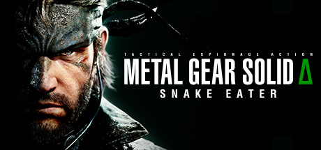

**Metal Gear Solid 3: Snake Eater (1964 setting, released 2004 by Konami, remade as Snake Eater Delta) follows Naked Snake on a jungle mission in Cold War Soviet territory.**

---

## 📖 About

Metal Gear Solid 3: Snake Eater (1964 setting, released 2004 by Konami, remade as Snake Eater Delta) follows Naked Snake on a jungle mission in Cold War Soviet territory. Its survival mechanics — hunting, treating wounds, camouflage — are ahead of their time and demand mastery on European Extreme difficulty.

## ⚠️ Problems Without Trainer

| Problem | Status |
|---------|--------|
| Stamina meter depletes quickly in combat requiring constant hunting detours | ✅ Solved |
| Wound infections spread without timely treatment removing combat effectiveness | ✅ Solved |
| Camouflage index must stay above 80 percent to avoid instant enemy detection | ✅ Solved |
| Boss battle patterns must be studied repeatedly without in-fight guidance | ✅ Solved |
| Alerting guards in early game cascades into unavoidable full-base lockdowns | ✅ Solved |

## ✅ Solution

The **Metal Gear Solid: Snake Eater Trainer** solves all these issues, giving you complete control so you can focus on enjoying the game.

## 🎯 Features

- Unlimited Resources / Currency
- God Mode / Invincibility
- Instant Skill & Ability Cooldown
- One-Hit Kill
- Freeze Timers
- Unlock All Items & Achievements
- Custom Speed Multiplier
- Infinite Stamina / Energy

## 🚀 Quick Start

1. **Disable Windows Defender** temporarily (trainer may trigger false positive)
2. Get the trainer from the button above
3. Launch Metal Gear Solid: Snake Eater
4. Run the trainer as Administrator
5. Use the hotkeys to activate cheats in-game

## 💎 Free vs Pro

| Feature | Free | Pro |
|---------|------|-----|
| God Mode | ✅ | ✅ |
| Unlimited Resources | ✅ | ✅ |
| Advanced Cheats | ❌ | ✅ |
| Auto-Updates | ❌ | ✅ |
| Priority Support | ❌ | ✅ |

## 💻 Requirements

- Windows 10 / 11 (64-bit)
- Metal Gear Solid: Snake Eater (any version)
- .NET Framework 4.8+
- DirectX 11+

## 🍎 macOS

## ⚖️ Legal

Educational and single-player use only.

---

